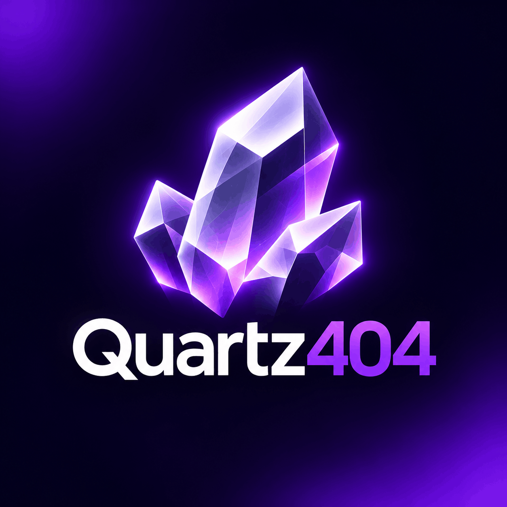

 <div align="center">



# `Quartz404`

**Crystallizing ideas into code.**

`TECH ADDICT` · `SYSTEMS ANALYST` · `REVERSE ENGINEER`

<br/>

[](https://github.com/Quartz404)
[](#)

</div>

---

```bash
$ whoami

> identity: Quartz404
> origin: unknown
> occupation: unknown
```

---

<div align="center">

### `404 — IDENTITY NOT FOUND`

*Stay curious. Keep building. Leave no trace.*


<sub>Quartz404 · An identity beyond the source code.</sub>

</div>
